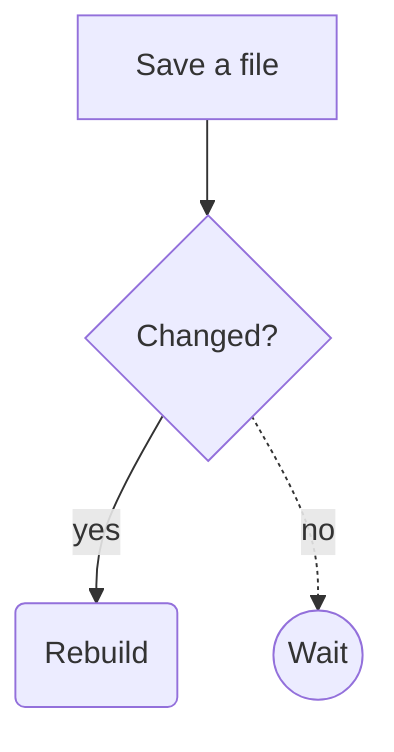

# Components

Mortise turns a few extra Markdown forms into styled components. They are
plain HTML with `mt-` classes and need no JavaScript. Their styles live in
`mortise.css`, which every build writes to the site root when at least one
page uses a component. Link it from your layout:

```html
<link rel="stylesheet" href="{{ site.baseurl }}/mortise.css">
```

Set `components_css: false` in `_config.yml` to skip the file and style the
classes yourself, or put your own `mortise.css` in the site, which takes
precedence. The showcase site's [components page](../examples/showcase/components.md)
uses every component.

## Callouts

GitHub's alert syntax: a block quote whose first line is a marker.

```markdown
> [!NOTE]
> Useful information.
```

Markers: `[!NOTE]`, `[!TIP]`, `[!IMPORTANT]`, `[!WARNING]`, `[!CAUTION]`
(any case). Output: `<div class="mt-callout mt-callout-note">` with a
`<p class="mt-callout-title">` and the content. Any other marker leaves the
block quote as it is.

## Containers

A container starts with three or more colons and a name, optionally
followed by a title, and ends at a line of at least as many colons. Its
content is Markdown. Nest containers by giving the outer one more colons.

| Container                | Renders as                                         |
| ------------------------ | -------------------------------------------------- |
| `:::card Title`          | A bordered card; the title is optional             |
| `::::grid`               | A responsive grid, usually holding `:::card`s      |
| `:::details Summary`     | A `<details>` disclosure with that summary         |
| `:::figure Caption`      | A `<figure>` with the content and a `<figcaption>` |
| `:::actions`             | Its links as buttons; the first is the primary one |
| `:::steps`               | Its ordered list as numbered steps                 |

```markdown
::::grid
:::card Fast
Incremental rebuilds.
:::
:::card Portable
Linux, macOS, and Windows.
:::
::::

:::actions
[Get started](/docs/) [Read more](/about/)
:::
```

Unknown names (`:::foo`) are not containers and stay paragraph text.

## Task lists

A list item starting with `[ ]` or `[x]` gets a checkbox:

```markdown
- [x] Write the parser
- [ ] Ship it
```

Output: `<li class="mt-task"><input type="checkbox" disabled checked aria-label="Done"> ...`.

## Footnotes

```markdown
Mortise is written in Zig[^zig].

[^zig]: A systems language.
    Indent further paragraphs by four spaces.
```

References are numbered in order of first use as `<sup class="mt-fnref">`
links, and the footnotes are listed at the end of the page in a
`<section class="mt-footnotes">`, each with a link back to the text. A
reference to a label with no definition stays literal text.

## Definition lists

A term line followed by one or more lines starting with `: `:

```markdown
Layout
: A template that wraps page content.
: Lives in _layouts/.
```

Output: `<dl class="mt-dl">` with `<dt>` and `<dd>` elements.

## Tabs and code groups

Tabs work without JavaScript: each tab is a radio button and its label,
and CSS shows the selected panel. A group holds up to 8 tabs.

```markdown
::::tabs
:::tab Overview
Any Markdown.
:::
:::tab Install
1. Install Zig.
:::
::::
```

`:::code-group` turns the code blocks inside it into tabs, labeled by each
block's `title` or else its language:

````markdown
:::code-group
```sh title="macOS"
brew install zig
```
```sh title="Windows"
winget install zig.zig
```
:::
````

Inside `:::tabs`, anything that is not a `:::tab` is left out.

## Code block options

After the language, a fence takes options (see the
[Markdown spec](markdown.md#fenced-code-blocks)):

````markdown
```zig title="src/main.zig" {4-5} lineNumbers
...
```
````

| Option        | Effect                                                   |
| ------------- | -------------------------------------------------------- |
| `title="..."` | A file-name bar above the code                           |
| `{2,4-6}`     | Marks those lines (1-based, inclusive ranges)            |
| `lineNumbers` | Numbers every line (CSS counters, so copying skips them) |

The language `diff` colors lines starting with `+`, `-`, and `@@`. Code
with options is wrapped in `<div class="mt-code">`, and each line is a
`<span class="mt-line">` with `mt-line-marked`, `mt-line-add`,
`mt-line-del`, or `mt-line-hunk` as needed.

## Heading anchors and copy buttons

Every Markdown heading ends with a `#` link to itself
(`<a class="mt-anchor" href="#id">#</a>`), shown when the heading is
hovered or the link has keyboard focus, so readers can copy a link to the
section.

Every fenced code block gets a Copy button
(`<button class="mt-copy" hidden>` inside its `<pre>`). Pages that have
code blocks load a small script, `/mortise-copy.js`, with
`<script src defer>` before `</body>`; the build writes it once, unless the
site has its own file there. It shows the buttons and copies the code,
without line numbers or diff markers, to the clipboard. Being a file
rather than inline, it works under a Content Security Policy of
`script-src 'self'`, and browsers cache it. It also keeps the first build
of a big site fast on Windows, whose virus scanner takes about twice as
long over each new page with inline script. Where the browser refuses clipboard access, the
button selects the code instead so the reader can press Ctrl+C. Without
JavaScript the buttons stay hidden.

Both are on by default. Turn them off in `_config.yml`:

```yaml
heading_anchors: false
copy_code: false
```

Feeds leave both out.

## Inline components

| Syntax         | Renders as                                   |
| -------------- | -------------------------------------------- |
| `:badge[New]`  | `<span class="mt-badge">New</span>`          |
| `:kbd[Ctrl]`   | `<kbd class="mt-kbd">Ctrl</kbd>`             |

The text is escaped and may not contain `]`.

## Charts

A fenced code block with the language `chart` is drawn as an SVG chart
during the build. The block holds settings in the
[frontmatter format](frontmatter.md):

````markdown
```chart
type: bar
title: Save to reload, by site size
labels: [100 pages, "1,000 pages", "10,000 pages"]
series:
  Linux: [4, 11, 96]
  Windows: [6, 16, 140]
suffix: " ms"
```
````

| Setting            | Meaning                                                   |
| ------------------ | --------------------------------------------------------- |
| `type`             | `bar` (default, grouped), `line`, `area`, `pie` or `donut` |
| `title`            | The caption, and the chart's accessible name              |
| `labels`           | One label per value: the x axis, or the slices            |
| `series`           | Named lists of numbers, up to six; shown with a legend    |
| `values`           | One unnamed list of numbers, instead of `series`          |
| `prefix`, `suffix` | Text around every number, such as `$` or `" ms"`          |
| `min`, `max`       | The value axis's range; by default it fits the data and includes 0 for bars and areas |
| `height`           | The drawing's height in pixels, 120 to 1200 (default 320); it is 640 wide and scales to the page |

Pie and donut charts show one series of non-negative numbers, with each
slice's share in the legend. Value axes use round steps (1, 2 or 5 times a
power of ten) and shorten large numbers to `k`, `M` and `G`. Hovering a
bar, point or slice shows its exact value.

The output is a `<figure class="mt-chart mt-chart-TYPE">` with the SVG, a
`<figcaption>` when there is a title, and a `<table class="mt-chart-data">`
of the same numbers that is hidden from sight but read by screen readers.
The SVG has no colors of its own: text follows the page's text color and
series use the classes `mt-chart-s1` to `mt-chart-s6`, colored by the
variables `--mt-chart-1` to `--mt-chart-6` (the first is `--mt-accent`).

A bad setting, a label count that does not match the values, or a value
that is not a number fails the build with the file and the line within
the block.

## Diagrams

A fenced code block with the language `mermaid` is drawn as an SVG
diagram during the build, so pages need no script. The syntax is a subset
of [Mermaid](https://mermaid.js.org/)'s, so the same block also renders
on GitHub and other sites that run Mermaid.

**Flowcharts** start with `graph` or `flowchart` and a direction: `TD`
(or `TB`), `BT`, `LR` or `RL`.

````markdown

````

| Syntax                         | Meaning                                  |
| ------------------------------ | ---------------------------------------- |
| `A[text]`, `A(text)`, `A([text])`, `A{text}`, `A((text))`, `A[(text)]` | Box, rounded box, stadium, diamond, circle, cylinder |
| `A --> B`, `A --- B`           | Arrow, plain line                        |
| `A -.-> B`, `A ==> B`          | Dotted, thick                            |
| `A -->\|label\| B`, `A -- label --> B` | A labeled link                   |
| `A --> B --> C`                | A chain of links                         |
| `;` or a new line              | Ends a statement; `%%` starts a comment  |

Nodes are placed in layers along the direction, ordered to keep links
from crossing; links that skip layers bend around the nodes between.
`classDef`, `class`, `style`, `linkStyle` and `click` lines are accepted
and ignored.

**Sequence diagrams** start with `sequenceDiagram`:

| Syntax                                  | Meaning                               |
| --------------------------------------- | ------------------------------------- |
| `participant A as Alice`, `actor B`     | A column (actors have rounded boxes)  |
| `A->>B: text`, `A-->>B: text`           | Solid and dashed messages             |
| `A->B`, `A-->B`, `A-)B`, `A-xB`         | Other arrow styles                    |
| `A->>A: text`                           | A message to itself                   |
| `Note right of A: text`, `Note over A,B: text` | Notes                          |
| `loop`, `alt`/`else`, `opt`, `par`/`and`, `critical`, `break` ... `end` | Labeled frames |

The figure is `<figure class="mt-diagram mt-diagram-flowchart">` (or
`-sequence`). It has no colors of its own: text and lines follow the
text color and nodes are outlined in `--mt-accent`, so themes restyle
diagrams through `mortise.css`. A diagram the build cannot read fails it
with the file and the line within the block.

## Theming

`mortise.css` mixes its neutral colors from the surrounding text color, so
components fit light and dark sites as they are. Override these variables
in your stylesheet to change the rest:

| Variable          | Used for                              |
| ----------------- | ------------------------------------- |
| `--mt-accent`     | Primary button, steps, badges         |
| `--mt-accent-text`| Text on the accent color              |
| `--mt-radius`     | Corner radius                         |
| `--mt-note`, `--mt-tip`, `--mt-important`, `--mt-warning`, `--mt-caution` | Callout colors |

## Shortcodes

Your own components: every template in `_includes/shortcodes/` is a
shortcode that Markdown pages can call on a line of its own.

```markdown



The body is **Markdown**, and may hold more shortcodes.

```

`` renders `_includes/shortcodes/NAME.html`.
A tag ending in `/>}}` (or one with no closing tag) has no body; otherwise
everything up to `` is rendered as Markdown and passed in.
Calls of the same shortcode can nest. The template sees:

| Variable  | Value                                                          |
| --------- | -------------------------------------------------------------- |
| `args`    | The arguments, as text: `{{ args.title }}`                     |
| `content` | The rendered body, for calls with one                          |
| `page`    | The calling page's frontmatter                                 |
| `site`    | The config from `_config.yml`                                  |

```html
<!-- _includes/shortcodes/aside.html -->
<aside class="aside"><strong>{{ args.title | default("Aside") }}</strong>{{ content }}</aside>
```

Argument values are quoted with `"` or `'`, or written bare when they
have no spaces. A missing template, a template error or a malformed call
stops the build at the shortcode's line. Editing a shortcode template
rebuilds the whole site.
