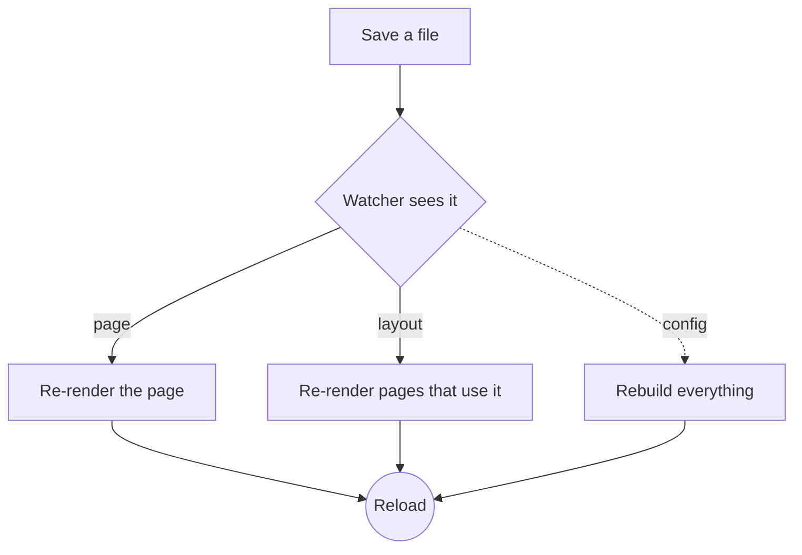
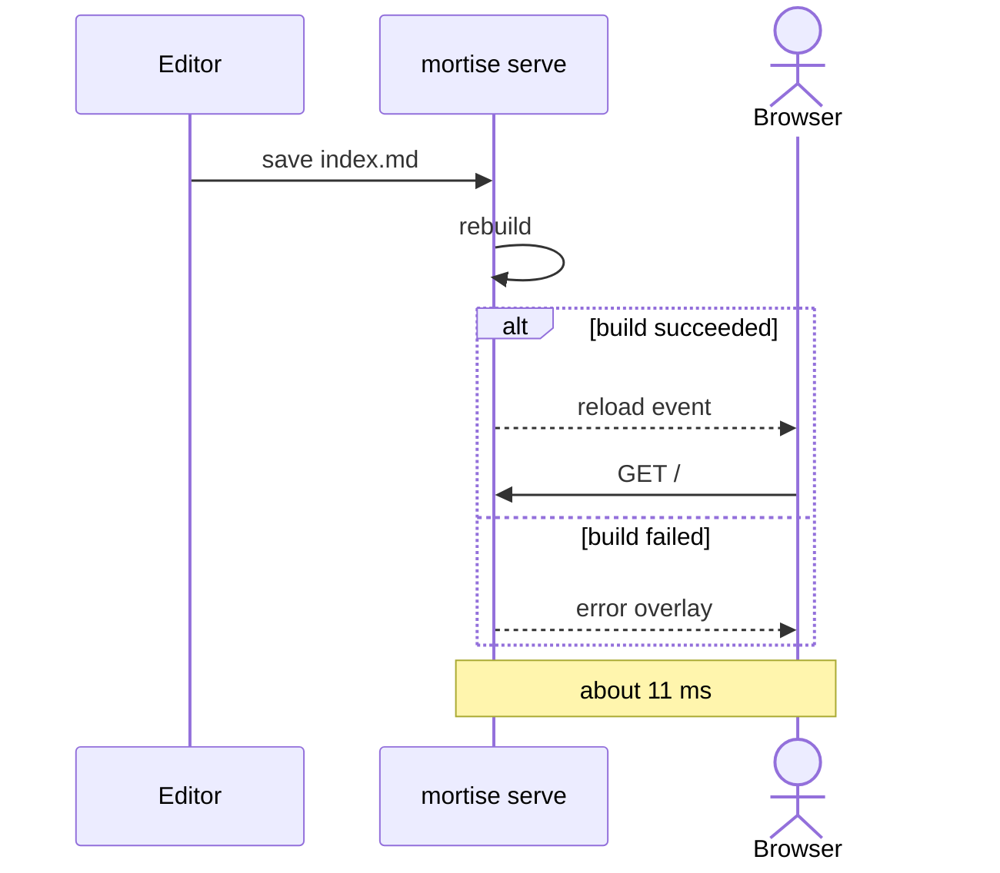

# Components

Mortise turns a few extra Markdown forms into styled components. Their
styles come from `mortise.css`, which the build writes whenever a page
uses one. Version :badge[new] · press :kbd[Ctrl] + :kbd[S] to save and watch
this page reload.

## Callouts

> [!NOTE]
> Callouts use GitHub's alert syntax, so they read well there too.

> [!TIP]
> Run `mortise serve` and edit this file to see changes in moments.

> [!IMPORTANT]
> Every component is plain HTML and CSS. No JavaScript is added.

> [!WARNING]
> `build` replaces `_site` on every run.

> [!CAUTION]
> Pages marked `draft: true` are only published with `--drafts`.

## Cards in a grid

::::grid
:::card Fast
Incremental rebuilds re-render only the pages a change affects.
:::
:::card Portable
One binary for Linux, macOS, and Windows, with native file watching.
:::
:::card Dependency-free
Everything is written in Zig on top of the standard library.
:::
::::

:::card A single card
Cards can hold any Markdown: **bold text**, `code`, and lists.

- one
- two
:::

## Buttons

:::actions
[Get started](/docs/) [Browse tags](/tags/) [Read the feed](/feed.xml)
:::

## Steps

:::steps
1. Create a site with `mortise new my-site`.
2. Run `mortise serve my-site` and open the printed address.
3. Edit Markdown in `my-site/` and watch the browser reload.
:::

## Details

:::details What does "Mortise" mean?
A mortise is a hole cut into wood to receive a tenon. Here, Markdown is
the tenon and your templates are the mortise.
:::

:::details Can I nest components?
Yes. Give the outer container more colons than the inner ones, as the
grid above does with `::::grid`.
:::

## Figure

:::figure The Mortise logo, as an SVG image with a caption.

:::

## Shortcodes

Templates in `_includes/shortcodes/` become Markdown shortcodes: a line
`` renders
`stat.html` with the arguments, and a pair of tags passes the Markdown
between them as `content`, so shortcodes can nest.








This box is the `aside` shortcode. Its body is **Markdown**, rendered
before the template wraps it.


## Charts

A fenced block with the language `chart` becomes an SVG chart at build
time, with a hidden table of the same numbers for screen readers.

```chart
type: bar
title: Save to reload, by site size
labels: [100 pages, "1,000 pages", "10,000 pages"]
series:
  Linux: [4, 11, 96]
  Windows: [6, 16, 140]
suffix: " ms"
```

```chart
type: line
title: Pages built per second
labels: [1, 2, 4, 8, 16]
series:
  threads: [900, 1700, 3200, 5600, 7400]
```

```chart
type: donut
title: Where a rebuild spends its time
labels: [Markdown, Templates, Writing, Other]
values: [38, 31, 22, 9]
suffix: "%"
```

## Diagrams

A `mermaid` code block is drawn as an SVG diagram at build time, so the
page needs no script; the same block also renders on GitHub.




